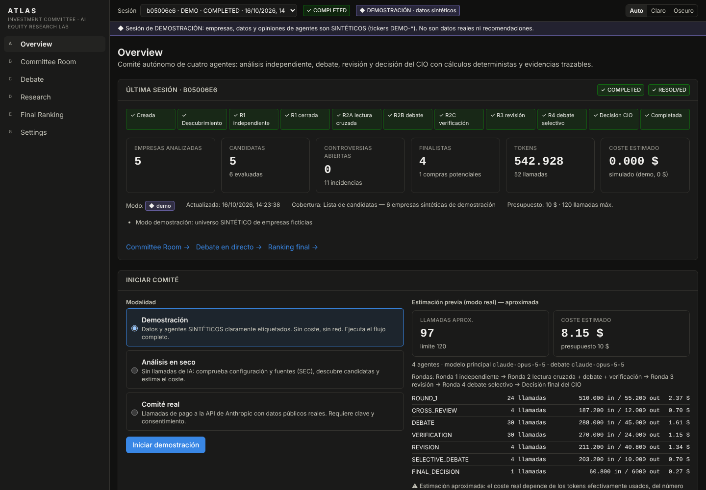
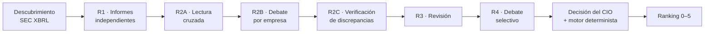

<div align="center">

# ATLAS Investment Committee

**Laboratorio de análisis de acciones con un comité de cuatro agentes de IA que investigan, debaten y deciden con datos públicos y cálculos trazables.**




</div>

> **Aviso.** ATLAS es una herramienta de investigación y aprendizaje, **no asesoramiento financiero**. Las estimaciones no garantizan rentabilidades; la rentabilidad objetivo es un criterio de selección, no una previsión, y recomendar **cero** compras es un resultado válido.

---

## Índice

- [Qué es](#qué-es)
- [Cómo funciona](#cómo-funciona)
- [Inicio rápido](#inicio-rápido)
- [Acceso a Claude: suscripción o API](#acceso-a-claude-suscripción-o-api)
- [Configuración](#configuración)
- [Uso](#uso)
- [Arquitectura](#arquitectura)
- [Desarrollo](#desarrollo)
- [Limitaciones](#limitaciones)
- [Seguridad](#seguridad)
- [Licencia](#licencia)

## Qué es

ATLAS reúne un comité de inversión de cuatro agentes con perfiles distintos:

| Agente | Papel |
|---|---|
| **Quality** | Calidad del negocio: márgenes, retorno sobre el capital, ventajas competitivas, gestión. |
| **Valuation** | Precio frente a valor: DCF, múltiplos históricos y comparables, margen de seguridad. |
| **Risk** | Riesgos y vetos: balance, dilución, litigios, concentración, riesgos del 10-K. |
| **CIO** | Modera el debate, clasifica controversias y propone el veredicto final. |

Cada agente trabaja en llamadas independientes al modelo, con sus propias instrucciones, herramientas y contexto autorizado. Los datos proceden de fuentes públicas (SEC EDGAR, Stooq, BCE) y todos los números pasan por un **motor de cálculo determinista**: el modelo argumenta, pero no inventa cifras ni decide la puntuación.

**Puntos clave**

- **Independencia real en la ronda 1:** ningún agente puede leer los informes de los demás hasta que los cuatro existen y quedan congelados (inmutables en SQLite).
- **Debate estructurado** entre agentes, con mensajes almacenados, evidencias citadas (`EV-n`) y respuestas encadenadas.
- **Registro de evidencias:** cada dato lleva fuente, URL, periodo, fecha y estado de verificación. Solo el sistema puede marcar algo como `VERIFIED`.
- **Lectura de 10-K/10-Q** con citas literales (`Item 1A ¶12 · pág. ≈23`).
- **El veredicto lo limita el motor:** el CIO puede ser más prudente que el motor, nunca menos.
- **Reanudable:** las tareas completadas nunca se repiten. Con la suscripción de Claude, la sesión se pausa al agotar la ventana de uso y se reanuda sola cuando se reinicia.
- **Modo demostración** con datos sintéticos, sin red ni coste, y **análisis en seco** sin llamadas de IA.

## Cómo funciona



1. **Descubrimiento:** criba el universo de la SEC (NYSE, Nasdaq, CBOE) por márgenes, flujo de caja y crecimiento, y excluye los sectores elegidos. También puedes importar tus propios tickers por CSV.
2. **Ronda 1:** cada agente analiza las candidatas por su cuenta.
3. **Ronda 2:** lectura cruzada, debate por empresa y verificación de las discrepancias factuales, que solo se resuelven con evidencia verificada, nunca por votación.
4. **Rondas 3 y 4:** revisión versionada de los informes y debate selectivo de las controversias que pueden cambiar la decisión.
5. **Decisión:** puntuación ponderada (calidad, valoración, rentabilidad potencial, solidez y catalizadores, con penalización por riesgo), vetos y ranking de **0 a 5** empresas, nunca rellenado para llegar a 5.

## Inicio rápido

**Requisitos:** Node.js ≥ 22.13 (usa el módulo integrado `node:sqlite`; no hay nada que compilar) y, para comités reales, una cuenta de Claude con [Claude Code](https://docs.claude.com/en/docs/claude-code) o una clave de API de Anthropic.

```bash
git clone https://github.com/Manulopsan/atlas-investment-committee.git
cd atlas-investment-committee
npm install
cp .env.example .env.local     # rellene SEC_USER_AGENT (ver Configuración)
npm run dev                    # http://localhost:3000
```

Para probarlo sin configurar nada, abre la app y lanza una **Demostración**.

> En Windows con WSL, clona el proyecto dentro del sistema de archivos de Linux (por ejemplo `~/atlas`) y no en `/mnt/c/...`: el arranque es varias veces más rápido.

## Acceso a Claude: suscripción o API

Se elige en **Settings → Acceso a Claude**.

| | Suscripción (por defecto) | API |
|---|---|---|
| Autenticación | La cuenta con la que Claude Code ha iniciado sesión en tu equipo (`claude` y después `/login`) | `ANTHROPIC_API_KEY` en `.env.local` |
| Consumo | Ventanas de uso de tu plan (5 horas y semanal) | Pago por token |
| Límite de la sesión | Tope configurable de la ventana de 5 h (95 % por defecto) | Presupuesto en USD y límite de llamadas |
| Al llegar al límite | **Pausa** y reanudación automática cuando se reinicia la ventana | Parada controlada con veredicto del CIO |

En modo suscripción, la app usa el [Claude Agent SDK](https://docs.claude.com/en/docs/agent-sdk/overview): las herramientas de los agentes se exponen como un servidor MCP local y el orquestador ejecuta cada herramienta él mismo. La cabecera muestra en todo momento el uso de tu ventana de 5 h, y antes de cada comité verás los tokens necesarios y el % de la ventana que se estima que consumirá (se calibra con tus comités anteriores).

> El modo suscripción está pensado para uso personal en tu propio equipo. Para ofrecer la aplicación a terceros, usa una clave de API y revisa los términos de uso de Anthropic.

## Configuración

### Variables de entorno (`.env.local`, solo en el servidor)

| Variable | Obligatoria | Uso |
|---|---|---|
| `SEC_USER_AGENT` | Para datos reales | La SEC exige un User-Agent con contacto, por ejemplo `Atlas Research tu@email.com`. |
| `ANTHROPIC_API_KEY` | Solo en modo API | Clave de la API de Anthropic. Nunca llega al navegador, ni a SQLite, ni a los logs. |
| `CLAUDE_CODE_OAUTH_TOKEN` | No | Token de `claude setup-token` para el modo suscripción en equipos sin sesión interactiva. |
| `ALPHAVANTAGE_API_KEY` | No | Proveedor de precios alternativo (plan gratuito). |
| `ATLAS_DB_PATH` | No | Ruta del fichero SQLite (por defecto `./data/atlas.db`). |
| `ATLAS_RUNNER` | No | `inprocess` (por defecto) o `worker` (la web solo encola y `npm run worker` ejecuta). |
| `ATLAS_WORKER_CONCURRENCY` | No | Sesiones en paralelo en el worker (por defecto 1). |
| `ATLAS_BASIC_AUTH` | No | `usuario:contraseña` para proteger la app si la expones en red. |

### Settings

Todo lo demás se ajusta desde la propia app, en **Settings**. Cada sesión congela su configuración al iniciarse, así que cualquier comité es reproducible.

- **Modelo y acceso:** modelo principal, modelo de debate, esfuerzo y tope de la ventana de uso.
- **Objetivo de inversión:** horizonte, rentabilidad objetivo, margen de seguridad, tasa de descuento, tolerancia al riesgo, estrategia, número máximo de finalistas y sectores excluidos.
- **Universo:** bolsas, segmentos por capitalización, número de candidatas y de empresas en el debate, y lista propia de tickers por CSV.
- **Límites:** rondas de debate, verificaciones por empresa, iteraciones de herramientas, concurrencia, tokens por llamada y presupuesto (modo API).
- **Proveedores de datos:** precios (Stooq, Alpha Vantage o manual) y divisa EUR/USD (BCE).

## Uso

1. **Demostración:** ejecuta el flujo completo con empresas ficticias `DEMO-*`, sin red ni coste. Todo queda etiquetado como sintético.
2. **Análisis en seco:** descarga el universo de la SEC, criba candidatas y estima el uso sin ninguna llamada de IA.
3. **Comité real:** revisa la estimación previa, acepta el consentimiento y lanza el comité. Sigue el progreso en **Committee Room** y **Debate**; el resultado aparece en **Final Ranking** y en las fichas de empresa. Puedes detener, reanudar o reintentar una tarea concreta.

**Exportaciones:** informe final (Markdown), tabla comparativa (CSV), informes por agente, transcripción del debate y registro de evidencias.

**Evaluaciones históricas:** ejecuta el comité en una fecha pasada (modo *point-in-time*) y compáralo con lo que ocurrió después:

```bash
npm run eval -- --demo                              # sintética y gratuita: valida el arnés
npm run eval -- --file evals/cases.example.json     # muestra la estimación; añada --confirm-cost para ejecutar
```

## Arquitectura

```
src/
  app/                  Páginas (Overview, Committee, Debate, Research, Ranking, Settings, Evals) y rutas API
  components/           Interfaz, gráficos y hooks (SSE + sondeo)
  lib/
    orchestrator/       Fases del comité, bucle de herramientas de cada agente, reanudación
    agents/             Perfiles, esquemas Zod de las salidas y control de acceso a informes
    llm/                Adaptadores: suscripción (Agent SDK), API de Anthropic y demo; uso y límites
    market-data/        SEC EDGAR, precios, divisa, 10-K, proveedor sintético
    evidence/           Registro y conciliación de evidencias
    finance/            Motor determinista: rentabilidades, valoración, puntuación y veredictos
    db/                 Esquema SQLite (con triggers de inmutabilidad) y repositorio
scripts/                worker.ts (ejecutor separado) y eval.ts (evaluaciones)
tests/                  Pruebas con Vitest
```

**Stack:** Next.js 15 (App Router), React, TypeScript, Tailwind CSS, Recharts, Zod, SQLite (`node:sqlite`), Claude Agent SDK y Anthropic SDK.

## Desarrollo

```bash
npm run dev         # servidor de desarrollo
npm test            # pruebas (Vitest)
npm run typecheck   # TypeScript
npm run lint        # ESLint
npm run check       # las tres anteriores
npm run build && npm start   # producción local
```

Para ejecutar las sesiones fuera del servidor web, pon `ATLAS_RUNNER=worker` en `.env.local` y lanza `npm run worker` en otra terminal.

## Limitaciones

- **Universo parcial:** el cribado usa los *frames* XBRL de la SEC por año natural; quedan fuera los emisores sin etiquetas estándar o con ejercicio desalineado. La app lo indica y nunca afirma una cobertura exhaustiva.
- **Precios gratuitos retrasados.** Sin un precio verificado no hay CAGR ni compra posible.
- **Aproximaciones:** el ROIC y la deuda neta son aproximados y se marcan con confianza media o baja.
- **Citas de 10-K:** solo HTML con texto (no PDFs escaneados), con páginas aproximadas.
- **Sesgo de anticipación:** el modo histórico no puede impedir que el modelo recuerde lo ocurrido después de la fecha de análisis.
- **Estimación de uso aproximada:** el control efectivo es la comprobación previa a cada llamada.

## Seguridad

Las claves solo viven en variables de entorno del servidor, y las respuestas y exportaciones pasan por un redactor de secretos. Las mutaciones exigen el mismo origen, y las URLs que abren los agentes pasan una guardia SSRF. El contenido recuperado se trata como dato no confiable. Los agentes no ejecutan código ni pueden cambiar instrucciones, configuración o límites: solo disponen de herramientas de datos y cálculo en lista blanca.

## Licencia

[MIT](LICENSE) © Manulopsan
